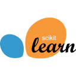
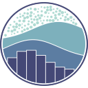

<h1 align="center">Hi, I'm Okan Kaya 👋</h1>
<h3 align="center">AI &amp; Data Science</h3>

  

I'm studying for an **M.Sc. in Industrial Mathematics at TU Dortmund**. I enjoy using mathematics and code to explore data, build machine learning models and solve applied problems.

- I'm building projects in **data analysis, machine learning and bioinformatics**.
- Recently, in **Simulation Techniques**, I've been working with **PowerShell, Python and Visual Studio** as part of my Industrial Mathematics MSc.
- In **Applied Numerical Computing and Deep Learning in Python**, I'm revisiting **Python fundamentals** and studying **numerical computing methods and machine learning**, building on what I already know.
- I'm looking for a **working student role in AI or data science in Dortmund and the surrounding area**.

## Tools I use

<table align="center">
  <tr>
    <td align="center" width="100"> <strong>Visual Studio</strong></td>
    <td align="center" width="100"> <strong>Python</strong></td>
    <td align="center" width="100"> <strong>Linux</strong></td>
    <td align="center" width="100"> <strong>PowerShell</strong></td>
  </tr>
  <tr>
    <td align="center" width="100"> <strong>SQL (SQLite)</strong></td>
    <td align="center" width="100"> <strong>Excel</strong></td>
    <td align="center" width="100"> <strong>MotherDuck</strong></td>
    <td align="center" width="100"> <strong>DuckDB</strong></td>
  </tr>
</table>

## Libraries and learning tools

My current Python learning also covers **VS Code, Anaconda and Seaborn**.

<table align="center">
  <tr>
    <td align="center" width="100"> <strong>R</strong></td>
    <td align="center" width="100"> <strong>NumPy</strong></td>
    <td align="center" width="100"> <strong>pandas</strong></td>
    <td align="center" width="100"> <strong>scikit-learn</strong></td>
  </tr>
  <tr>
    <td align="center" width="100"> <strong>Matplotlib</strong></td>
    <td align="center" width="100"> <strong>VS Code</strong></td>
    <td align="center" width="100"> <strong>Anaconda</strong></td>
    <td align="center" width="100"> <strong>Seaborn</strong></td>
  </tr>
</table>

  

I'm exploring **ChatGPT Data** for assisted analysis and documentation.

## Selected projects

- **[Retail sales with Python and SQL](https://github.com/OkanKaya07/data-science-portfolio/tree/main/projects/01-retail-analytics)** — Cleaning invoice data and comparing monthly sales, order counts and average order value.
- **[Bike demand estimation](https://github.com/OkanKaya07/data-science-portfolio/tree/main/projects/03-bike-demand)** — Comparing regression models with validation that keeps later dates separate.
- **[Excel bike rental dashboard](https://github.com/OkanKaya07/data-science-portfolio/tree/main/projects/04-excel-bike-operations)** — Exploring seasonal demand with filters, formulas and charts.
- **[Pasilla RNA-seq exploration](https://github.com/OkanKaya07/data-science-portfolio/tree/main/projects/07-pasilla-rnaseq)** — Inspecting sample variation with normalization and PCA.

[All projects](https://github.com/OkanKaya07/data-science-portfolio) · [My website](https://okankaya07.github.io/)

## Connect with me

[LinkedIn](https://www.linkedin.com/in/okan-kaya-708a2a279) · [Email](mailto:okankaya0207@gmail.com)
