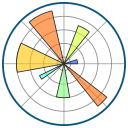

<h1 align="center">Hi, I'm Okan Kaya 👋</h1>

<h3 align="center">Industrial Mathematics · Python, SQL &amp; Data Science</h3>

I'm an **M.Sc. Industrial Mathematics student at TU Dortmund** and a Mathematics graduate from Yeditepe, where I finished first in my department. My **Python, SQL and Excel** projects focus on data quality, analysis and reproducible results.

I'm looking for a **working student role in AI or data science in Dortmund and the surrounding area**.

## Selected projects

- **[Retail data quality and SQL reporting](https://github.com/OkanKaya07/data-science-portfolio/tree/main/projects/01-retail-analytics)** — Audited **541,909 invoice lines** before reporting monthly positive sales, distinct orders and average order value with SQL CTEs and `LAG`.
  [SQL](https://github.com/OkanKaya07/data-science-portfolio/blob/main/sql/retail.sql) · [Audit](https://github.com/OkanKaya07/data-science-portfolio/blob/main/reports/retail_audit.json) · [Results](https://github.com/OkanKaya07/data-science-portfolio/blob/main/reports/monthly_sales.csv)
- **[Air-quality validation pipeline](https://github.com/OkanKaya07/data-science-portfolio/tree/main/projects/05-python-air-quality)** — Parsed **9,357 observations** into SQLite, preserved missing values as `NULL`, and checked duplicate timestamps and repeated loading.
  [Code](https://github.com/OkanKaya07/data-science-portfolio/blob/main/projects/05-python-air-quality/air_quality.py) · [Tests](https://github.com/OkanKaya07/data-science-portfolio/blob/main/projects/05-python-air-quality/test_air_quality.py) · [Results](https://github.com/OkanKaya07/data-science-portfolio/blob/main/projects/05-python-air-quality/reports/daily_summary.csv)
- **[Excel bike rental dashboard](https://github.com/OkanKaya07/data-science-portfolio/tree/main/projects/04-excel-bike-operations)** — A filterable workbook covering **731 days**, with **3,292,679 rentals reconciled to the source with zero difference**.

[All nine projects, including machine learning and bioinformatics](https://github.com/OkanKaya07/data-science-portfolio) · [My website](https://okankaya07.github.io/)

  

## Development and analysis toolbox

<table align="center">
  <tr>
    <td align="center" width="100"> <strong>Visual Studio</strong></td>
    <td align="center" width="100"> <strong>Python</strong></td>
    <td align="center" width="100"> <strong>Linux</strong></td>
    <td align="center" width="100"> <strong>PowerShell</strong></td>
  </tr>
  <tr>
    <td align="center" width="100"> <strong>SQL (SQLite)</strong></td>
    <td align="center" width="100"> <strong>Excel</strong></td>
    <td align="center" width="100"> <strong>MotherDuck</strong></td>
    <td align="center" width="100"> <strong>DuckDB</strong></td>
  </tr>
</table>

**MotherDuck and DuckDB are part of my current SQL learning.** The linked pipeline and reporting projects currently use SQLite.

## Libraries and learning tools

VS Code, Anaconda and Seaborn are tools I'm exploring alongside my coursework and projects.

<table align="center">
  <tr>
    <td align="center" width="100"> <strong>R</strong></td>
    <td align="center" width="100"> <strong>NumPy</strong></td>
    <td align="center" width="100"> <strong>pandas</strong></td>
    <td align="center" width="100"> <strong>scikit-learn</strong></td>
  </tr>
  <tr>
    <td align="center" width="100"> <strong>Matplotlib</strong></td>
    <td align="center" width="100"> <strong>VS Code</strong></td>
    <td align="center" width="100"> <strong>Anaconda</strong></td>
    <td align="center" width="100"> <strong>Seaborn</strong></td>
  </tr>
</table>

## Recently

- In **Simulation Techniques**, I've been working with **PowerShell, Python and Visual Studio** as part of my Industrial Mathematics MSc.
- In **Applied Numerical Computing and Deep Learning in Python**, I'm revisiting **Python fundamentals** and studying **numerical computing methods and machine learning**, building on what I already know.

## AI tools and agent workflows

<table align="center">
  <tr>
    <td align="center" width="150"> <strong>ChatGPT</strong></td>
    <td align="center" width="150"> <strong>Codex</strong></td>
    <td align="center" width="150"> <strong>Gemini</strong></td>
  </tr>
  <tr>
    <td align="center" width="150"> <strong>Google Antigravity</strong></td>
    <td align="center" width="150"> <strong>Claude Code</strong></td>
    <td align="center" width="150"> <strong>Subagent workflows</strong></td>
  </tr>
</table>

I use **ChatGPT, Codex, Gemini, Google Antigravity and Claude Code** to support coding, documentation and debugging. I'm exploring **subagent workflows** for planning, implementation and review, and check generated code against source data and tests.

I'm also exploring **ChatGPT Data** for assisted analysis. The educational portfolio describes AI assistance and links the code, source data and validation checks.

## Connect with me

[LinkedIn](https://www.linkedin.com/in/okan-kaya-708a2a279) · [Email](mailto:okankaya0207@gmail.com)
